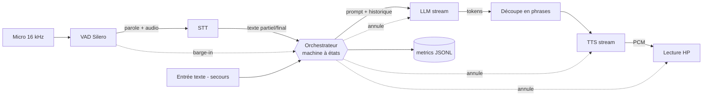

# Architecture

## Flux (cascade, client Python local)

Toutes les briques tournent en tâches `asyncio` reliées par des files bornées ; chaque événement horodaté part vers `src/metrics`.

## Machine à états
États : `IDLE_LISTENING` → `USER_SPEAKING` → `THINKING` → `AGENT_SPEAKING` → (`BARGE_IN`) → `USER_SPEAKING`.
| Transition | Déclencheur |
|---|---|
| IDLE → USER_SPEAKING | VAD : parole détectée (durée min) |
| USER_SPEAKING → THINKING | VAD : silence > seuil de fin de tour (endpoint) → STT final |
| THINKING → AGENT_SPEAKING | premier chunk audio TTS prêt à jouer |
| AGENT_SPEAKING → IDLE | fin de lecture |
| AGENT_SPEAKING/THINKING → BARGE_IN | VAD : parole utilisateur > durée min pendant la sortie |
| BARGE_IN → USER_SPEAKING | annulation terminée |
Le seuil de fin de tour et la durée min de barge-in sont des paramètres de `configs/` (valeurs à fixer par mesure).

## Points de mesure
Définitions exactes dans @docs/METRICS.md. Événements : `vad_speech_start`, `vad_speech_end`, `stt_first_partial`, `stt_final`, `llm_request`, `llm_first_token`, `llm_done`, `tts_request`, `tts_first_byte`, `playback_first_sample`, `barge_in_detected`, `playback_stopped`, `llm_cancelled`.

## Annulation sur interruption (ordre)
1. Couper la lecture (vider le buffer du périphérique audio) → `playback_stopped`.
2. Annuler la requête TTS en cours et purger la file PCM.
3. Annuler le flux LLM (fermer la requête) et vider la file de phrases.
4. Tronquer l'historique : ne garder que le texte **réellement joué** (suivi des échantillons lus → phrases complètes lues + éventuelle marque d'interruption) ; ne pas laisser dans le contexte du texte que l'utilisateur n'a pas entendu.
5. Repasser en `USER_SPEAKING` en réutilisant l'audio capté depuis la détection (pré-roll) pour ne pas perdre le début de la phrase.

## Écho
Casque recommandé pour les mesures. Sans casque : coupure de la détection pendant les premières ms de lecture + seuil relevé, ou AEC (voir RISKS_AND_PLAN_B).

## Mode texte de secours
Même orchestrateur, source `TXT` à la place de VAD+STT ; sortie texte (et TTS optionnel). Activé : par option, ou automatiquement si STT/audio indisponible. Les traces gardent les mêmes champs (étapes audio absentes).

## Mode replay
Une source `AudioFile` horodatée remplace le micro (même interface) ; permet tests, bruit contrôlé et plan B.

## Protocole WebSocket du prototype (`/ws`)
Client → serveur : binaire = PCM16 16 kHz mono (trames de 512 échantillons) ; JSON `{"type":"text","text":…}` (mode texte), `{"type":"playback_ended"}`.
Serveur → client : binaire = PCM16 24 kHz mono ; JSON `ready`, `state` (listening/thinking/speaking), `vad`, `transcript`, `agent_chunk`, `metrics`, `audio_end`, `error`.

## Structure cible
```
CLAUDE.md
docs/
src/  audio/ vad/ stt/ llm/ tts/ orchestrator/ transport/ metrics/ fallback/
tests/
scripts/   (campagnes, génération de bruit, replay)
data/      (audio, traces ; gitignoré)
notebooks/ (analyse)
configs/
```
`transport/` = E/S : WebSocket navigateur (client principal, voir TECH_STACK), source fichier (replay), source texte. Le flux ci-dessus se lit « MIC = navigateur → WebSocket » et « PLAY = WebSocket → navigateur ».
