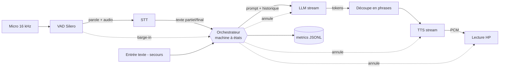

# Architecture

## Flux (cascade, navigateur + serveur FastAPI)

Toutes les briques tournent en tâches `asyncio` reliées par des files `asyncio.Queue` **non bornées** (le TTS produit plus vite que le temps réel : le PCM d'une réponse attend dans la file, hypothèse : quelques secondes d'audio au plus, non mesuré) ; chaque événement horodaté part vers `src/metrics`.

## Modules de l'orchestrateur (`src/orchestrator/`)
`session.py` est un coordinateur mince ; configuration : `SessionConfig` (depuis `configs/base.yaml`) et dépendances : `SessionDeps` (`session_config.py`).
| Module | Responsabilité |
|---|---|
| `capture.py` | trames micro → porte de niveau (`vad.min_level_dbfs`) → VAD → endpointer, seuil relevé quand l'agent parle, STT spéculatif |
| `turn_runner.py`, `turn_metrics.py` | un tour : accroche, `run_turn`, historique, message `metrics` |
| `waiting.py` | accroche d'ouverture, annonce de recherche, 2e phrase d'attente |
| `interruption.py`, `truncation.py` | barge-in, texte entendu, accusé du client |
| `state.py`, `response.py`, `history.py`, `tasks.py` | états autorisés ; état d'une réponse ; historique (seul écrivain) ; tâches asyncio (`cancel_all`) |
| `turn.py`, `chunker.py` | STT → LLM → TTS par morceaux, découpe en phrases |

## Machine à états
Implémentée dans `src/orchestrator/state.py` (`State`, table `ALLOWED`, `StateMachine`). Une transition illégale lève une erreur si `session.strict_transitions` est vrai (tests), sinon elle est tracée (`state_illegal`) et appliquée. Chaque changement émet la trace `state_change` (`from`, `to`).
| État | Sens | Envoyé au client |
|---|---|---|
| `LISTENING` | micro écouté ; la parole de l'utilisateur est suivie par l'endpointer (`in_speech`), ce n'est pas un état | `listening` |
| `THINKING` | fin de tour déclarée : STT, LLM, accroche éventuelle | `thinking` |
| `SPEAKING` | premier audio envoyé (accroche comprise) | `speaking` |
| `BARGE_IN` | transitoire : annulation des tâches et troncature de l'historique | jamais (le client reçoit `interrupt` puis `listening`) |
| Transition | Déclencheur |
|---|---|
| LISTENING → THINKING | endpointer : fin de parole (`vad.end_silence_ms`) ou texte saisi |
| THINKING → SPEAKING | premier audio envoyé |
| THINKING/SPEAKING → LISTENING | fin de lecture (accusé `playback_ended` ou filet `session.failsafe_margin_s`), tour sans audio, ou erreur |
| THINKING/SPEAKING → BARGE_IN | parole utilisateur ≥ `session.barge_in_min_speech_ms` au-dessus de `session.barge_in_min_prob` pendant la sortie, ou texte saisi |
| BARGE_IN → LISTENING | annulation terminée |
Les seuils sont dans `configs/base.yaml` (section `vad`, `session`) ; leurs valeurs sont fixées par mesure (voir DECISIONS), pas ici.

## Points de mesure
Définitions exactes dans @docs/METRICS.md. Événements : `state_change`, `state_illegal`, `task_error`, `vad_speech_start`, `vad_speech_end`, `stt_first_partial`, `stt_final`, `llm_request`, `llm_first_token`, `llm_done`, `tts_request`, `tts_first_byte`, `playback_first_sample`, `barge_in_detected`, `playback_stopped`, `llm_cancelled`.

## Annulation sur interruption (ordre)
1. Couper la lecture (vider le buffer du périphérique audio) → `playback_stopped`.
2. Annuler la requête TTS en cours et purger la file PCM.
3. Annuler le flux LLM (fermer la requête) et vider la file de phrases.
4. Tronquer l'historique : ne garder que le texte **réellement joué** (suivi des échantillons lus → phrases complètes lues + éventuelle marque d'interruption) ; ne pas laisser dans le contexte du texte que l'utilisateur n'a pas entendu. Deux temps, un seul écrivain (`History`) : estimation du serveur à l'interruption (`History.interrupt`), puis affinage avec la durée jouée renvoyée par le client (`History.refine`, idempotent, vise le message par référence et non par index ; les accusés du client sont appariés aux interruptions dans l'ordre, ignorés après `session.interrupt_ack_timeout_s`).
5. Repasser en `LISTENING` en réutilisant l'audio capté depuis la détection (pré-roll) pour ne pas perdre le début de la phrase.

## Accès internet (function calling)
Le LLM reçoit l'outil `web_search`. Flux : 1re requête en flux → si `tool_calls` (ou balises DSML en texte, retenues par `ToolMarkupGuard`) → `SearchNotice` dans le flux → la session joue une accroche de recherche (si aucun morceau de réponse n'est encore parti) → `WebSearch.search` (OpenRouter, plugin `web`) → 2e requête (sans outil) avec le résultat → réponse en flux, découpée et synthétisée comme d'habitude. Une recherche au plus par réponse ; l'historique garde accroches + réponse, pas le résultat brut.

### Attente de recherche
Le LLM remplit `announce` (phrase courte qui dit ce qu'il cherche) ; la session la synthétise pendant la recherche et la joue avant la réponse (repli : accroche générique pré-enregistrée). Si rien n'a commencé `filler.search_wait_after_s` après l'avis de recherche, une 2e phrase brève est jouée. Les rangs des morceaux ne doivent plus se décaler dès que la réponse démarre.

## STT spéculatif et repli
Dès `stt.speculative_ms` de silence dans un énoncé, la session lance le STT sur l'audio déjà capté ; la parole qui reprend l'annule ; à la fin de tour, `run_turn(stt_task=…)` réutilise la tâche. Secours TTS : `FallbackTTS` (2e modèle, avant le 1er octet) ; si tout le TTS échoue, le texte reste affiché (`tts_down`). LLM : erreur réseau ou absence de 1er jeton après `llm.first_token_timeout_s` → `LLM_MODEL_ALT` (avant tout texte émis). Une transcription vide ou de bruit (`stt.ignore_phrases`) n'ouvre pas de tour (message `ignored`). Si le STT échoue : repli `FallbackSTT` (2e fournisseur), puis après `stt.fallback_to_text_after` échecs consécutifs la session passe en `text_only` (micro ignoré) jusqu'à `voice_retry`.

## Écho
Casque recommandé pour les mesures. Sans casque : coupure de la détection pendant les premières ms de lecture + seuil relevé, ou AEC (voir RISKS_AND_PLAN_B).

## Mode texte de secours
Même orchestrateur, source `TXT` à la place de VAD+STT ; sortie texte (et TTS optionnel). Activé : par option, ou automatiquement si STT/audio indisponible. Les traces gardent les mêmes champs (étapes audio absentes).

## Mode replay
Une source `AudioFile` horodatée remplace le micro (même interface) ; permet tests, bruit contrôlé et plan B.

## Protocole WebSocket du prototype (`/ws`)
Accès : en-tête `Origin` contrôlé (`server.allowed_origin_hosts`, refus 1008), une seule session à la fois (2e connexion : `error` puis fermeture 1013, après `server.busy_grace_s`). Messages malformés ignorés (trace `ws_bad_message`), texte limité à `server.max_text_chars` (sinon `error`).
Client → serveur : binaire = PCM16 16 kHz mono (trames de 512 échantillons) ; JSON `{"type":"text","text":…}` (mode texte), `{"type":"playback_started","in_ms":…}` (premier échantillon de la réponse planifié, audible dans `in_ms` ms ; 0 ≤ `in_ms` ≤ `server.max_playback_lead_ms` ; une fois par réponse ; ignoré sinon), `{"type":"playback_ended"}`, `{"type":"interrupted","played_s":…}`, `{"type":"voice_retry"}`, `{"type":"mute","muted":bool}` (micro coupé : trames non envoyées, serveur sourd, énoncé en cours abandonné ; le texte reste possible).
Serveur → client : binaire = PCM16 24 kHz mono ; JSON `ready` (voix), `state` (listening/thinking/speaking), `vad`, `transcript`, `agent_chunk`, `searching`, `metrics`, `audio_end`, `interrupt`, `truncate`, `fallback` (`mode`: text/voice), `tts_down`, `ignored` (transcription vide ou bruit : pas de réponse, la bulle de l'utilisateur est retirée), `error`.

## Structure cible
```
CLAUDE.md
docs/
src/  audio/ vad/ stt/ llm/ search/ tts/ orchestrator/ transport/ metrics/ fallback/ replay/
tests/
scripts/   (campagnes, génération de bruit, replay)
data/      (audio, traces ; gitignoré)
notebooks/ (analyse)
configs/
```
`transport/` = E/S : WebSocket navigateur (client principal, voir TECH_STACK), source fichier (replay), source texte. Le flux ci-dessus se lit « MIC = navigateur → WebSocket » et « PLAY = WebSocket → navigateur ».
