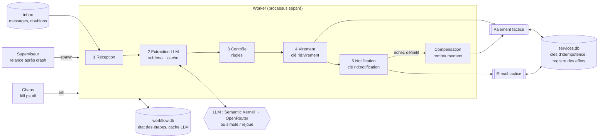

# Notes de frais sous chaos — workflow agentique résilient et idempotent

## Groupe

- @nathan138
- @Marko075
- @Neyhala

Slides de la soutenance : [slides/presentation-B5.pdf](slides/presentation-B5.pdf).

## Sujet

- **Identifiant du catalogue :** B5 — Workflow agentique résilient et idempotent
- **Problématique :** un workflow qui appelle un LLM puis déclenche des effets externes (virement, e-mail) peut-il
  subir des crashs brutaux, des doublons de livraison et des pannes transitoires sans jamais répéter ses effets ?
  Cas d'usage : traitement de notes de frais écrites en texte libre.
- **MVP :** 5 étapes persistées (réception et dédoublonnage, extraction LLM, contrôle, virement simulé, notification
  simulée), clés d'idempotence, reprise après crash, compensation du virement si la notification échoue, campagne
  d'au moins 40 pannes injectées comparée à une baseline naïve.

## Architecture



- **Moteur** ([engine.py](src/notesfrais/engine.py)) : mode protégé (étapes persistées en SQLite WAL, clés
  d'idempotence `request_id:étape`, cache LLM, compensation) et mode naïf (baseline : mêmes étapes et mêmes retries,
  sans état ni clé).
- **Services externes simulés** ([services.py](src/notesfrais/services.py)) : paiement et e-mail dans une base séparée
  du workflow, avec pannes configurables (erreur 500, timeout après application de l'effet).
- **LLM** ([llm.py](src/notesfrais/llm.py)) : Semantic Kernel avec le connecteur OpenAI pointé sur OpenRouter, modèle
  `qwen/qwen3.8-flash`, sortie JSON validée par un schéma Pydantic. Un LLM simulé déterministe sert aux tests et à la
  campagne.
- **Pannes** ([supervisor.py](src/notesfrais/supervisor.py), [chaos.py](src/notesfrais/chaos.py),
  [faults.py](src/notesfrais/faults.py)) : superviseur qui relance le worker, kills aléatoires, points de crash.
- **Mesures** ([metrics.py](src/notesfrais/metrics.py), [campaign.py](src/notesfrais/campaign.py)) et journal JSON Lines.

## Installation

```bash
cd groupe-transformers
python -m venv .venv
.venv\Scripts\activate          # macOS/Linux : source .venv/bin/activate
pip install -r requirements.txt
pip install -e .
```

Python ≥ 3.11. Copier `.env.example` vers `.env` et renseigner `OPENROUTER_API_KEY` (nécessaire uniquement pour le
vrai LLM). Ne jamais commiter `.env`.

## Utilisation

Toujours depuis le dossier `groupe-transformers`, environnement activé (`.venv\Scripts\activate`). Aucune clé ni
connexion n'est nécessaire pour la démo : le LLM y est simulé.

**Démo dans le terminal (~25 s)**

```bash
python -m demo
```

Les 40 notes de frais sont traitées en mode naïf puis en mode protégé, pendant que le worker est tué au hasard. Les
effets en double s'affichent en rouge (mode naïf) ou en vert à 0 (mode protégé), puis un tableau comparatif s'affiche.

**Démo interactive dans le navigateur**

```bash
python -m notesfrais dashboard
```

1. Choisir le mode (protégé ou naïf) dans la barre latérale, puis cliquer sur **Lancer la campagne**.
2. Cliquer sur **Tuer le worker maintenant** : le superviseur relance le worker, qui reprend la demande en cours.
3. Observer le compteur **Effets en double** (0 en mode protégé) et le journal en direct. `Ctrl+C` dans le terminal
   pour arrêter.

**Autres commandes**

```bash
python -m notesfrais campaign        # campagne de pannes (2 modes × 5 seeds) + rapport results/report.html
python -m notesfrais check-llm       # 1 appel au vrai LLM pour vérifier la clé
python -m notesfrais real-run        # vrai LLM sur 10 demandes (~10 appels)
python -m notesfrais --help          # liste complète
```

## Tests

```bash
python -m pytest
```

Résultat : 56 tests réussis, hors ligne. Cas couverts : crash avant et après chaque effet (exactement un effet après
reprise), mêmes crashs en mode naïf (effet doublé), demande livrée deux fois, erreurs 500 et timeouts, retries
épuisés, compensation, entrée vide, JSON invalide du LLM, API LLM indisponible, crash réel de processus.

## Résultats et évaluation

**Baseline :** mode naïf. **Protocole :** 40 notes de frais synthétiques, 15 % livrées deux fois, 5 seeds par mode,
worker tué aléatoirement, pannes 500/timeout sur les services, pannes du LLM simulé. **Métriques :** complétion,
effets dupliqués, demandes incohérentes (effets ≠ statut final), temps de reprise, appels LLM.

| 5 runs par mode | Naïf | Protégé |
|---|---:|---:|
| Crashs du worker injectés | 65 | 49 |
| Pannes injectées au total | 201 | 146 |
| Complétion | 100 % | 100 % |
| Effets en double | 94 | 0 |
| Demandes incohérentes | 44 / 200 | 0 / 200 |
| Étapes refaites après crash | 278 | 0 |
| Appels LLM | 303 | 213 |
| Reprise p50 / p95 | 0,36 s / 0,40 s | 0,41 s / 0,47 s |

**Interprétation :** le mode naïf termine toutes ses demandes mais dans un état faux (virements payés plusieurs fois,
compensations incomplètes). Le mode protégé n'a aucun doublon, au prix d'une reprise légèrement plus lente.
Vrai LLM sur 10 demandes : 100 % des champs corrects, un crash après l'appel LLM récupéré par le cache sans nouvel
appel. Détails : [results/report.html](results/report.html) et [notebooks/analyse.ipynb](notebooks/analyse.ipynb).

## Limites et plan B

- Services de paiement et d'e-mail simulés ; un seul worker à la fois.
- Qualité d'extraction du vrai LLM mesurée sur 10 demandes seulement.
- Coût : 11 appels réels au total ; plafond de 150 appels imposé par le code.
- Dépendance externe : OpenRouter, uniquement pour le mode réel.
- Plan B : la démo ne dépend ni du réseau ni d'une clé (LLM simulé) ; les résultats de la campagne sont consultables
  hors ligne dans `results/report.html`.

## Répartition du travail

| Membre | Contribution principale |
|---|---|
| @nathan138 | persistance SQLite, clés d'idempotence, compensation, superviseur et chaos, baseline naïve, campagne de pannes et métriques, intégration et PR, démo |
| @Marko075 | fork et dossier de groupe, scénario et données synthétiques, extraction LLM (Semantic Kernel / OpenRouter), règles de contrôle, vrai LLM, tests automatiques |
| @Neyhala | tableau de bord Streamlit, démo terminal, rapport et notebook d'analyse, slides, préparation de la soutenance |

## Licence et références

- Code sous licence MIT. Données entièrement synthétiques. Modèle `qwen/qwen3.8-flash` via OpenRouter.
- Bibliothèques : Semantic Kernel (MIT), openai (Apache-2.0), Pydantic (MIT), psutil (BSD-3), Streamlit (Apache-2.0),
  pandas (BSD-3), matplotlib.
- CoursIA : [06-SemanticKernel-ProcessFramework](https://github.com/jsboige/CoursIA/blob/main/MyIA.AI.Notebooks/GenAI/SemanticKernel/06-SemanticKernel-ProcessFramework.ipynb),
  [09_Production_Patterns](https://github.com/jsboige/CoursIA/blob/main/MyIA.AI.Notebooks/GenAI/Texte/09_Production_Patterns.ipynb)
- [AWS — Making retries safe with idempotent APIs](https://aws.amazon.com/builders-library/making-retries-safe-with-idempotent-APIs/),
  [Microsoft — Compensating Transaction pattern](https://learn.microsoft.com/en-us/azure/architecture/patterns/compensating-transaction),
  [Stripe — Idempotent requests](https://docs.stripe.com/api/idempotent_requests)
