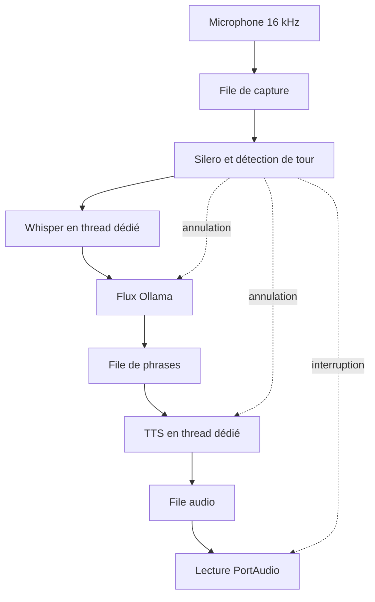

# VoiceAgent FR

Agent vocal local en français pour EndeavourOS/PipeWire et RTX 3070 Ti 8 Go :
Silero VAD → faster-whisper → Ollama → Kokoro, avec repli Piper, interruption à la voix,
historique de six tours, traces JSONL et rapports reproductibles.

**État de la livraison :** code et tests exécutés en environnement CPU sans périphérique audio.
La session `runs/validation-simulated` vérifie l'orchestration avec des doublures.
Les objectifs de latence, de WER, de VRAM et d'annulation d'écho sur le PC cible restent à
mesurer, de même que la vidéo live. La route cloud et le routage automatique (P2) ne sont
pas implémentés ; aucun appel payant.

## Groupe

| Membre | Contribution principale |
|---|---|
| Nicolas Danquigny | À compléter |
| Quentin Dufour | À compléter |

## Sujet

- **Identifiant du catalogue :** à compléter
- **Problématique :** une conversation vocale fluide exige des réponses rapides et la
  possibilité de couper la parole à l'assistant. Peut-on l'obtenir entièrement en local, en
  français, sur un GPU grand public de 8 Go, sans envoyer l'audio dans le cloud, tout en
  mesurant honnêtement latence, erreurs de transcription et qualité de l'interruption ?
- **MVP :** une conversation à la fois, en local et en français, avec pipeline vocal
  complet, interruption (barge-in), traces d'événements, replay de WAV avec bruit et
  statistiques (p50/p95, WER, intervalles de confiance). La route cloud et le routage
  automatique (P2) sont hors périmètre de cette livraison.

## Architecture

La capture PortAudio alimente une file bornée depuis son callback. Le consommateur asyncio
calcule la probabilité Silero sur CPU, accumule un segment et déclenche un tour. La capture
continue pendant la réponse, ce qui permet d'interrompre l'agent.



| Composant | Modèle / service | Rôle |
|---|---|---|
| VAD | Silero VAD (ONNX, CPU) | Début et fin de parole, validation de l'interruption (10 blocs de 32 ms) |
| STT | faster-whisper `large-v3-turbo` (CUDA, `int8_float16`) | Transcription du segment terminé |
| LLM | Ollama, `qwen2.5:3b-instruct-q4_K_M` (processus séparé) | Réponse en flux NDJSON |
| TTS | Kokoro 82M, voix `ff_siwis` ; repli Piper `fr_FR-siwis-medium` (CPU) | Synthèse phrase par phrase |

Choix structurants : une tâche de réponse possède un `TaskGroup` de trois tâches (LLM, TTS,
lecture) et ses propres files ; les imports lourds sont retardés ; chaque moteur natif a un
exécuteur mono-thread, car un appel CUDA déjà lancé ne peut pas être tué (son résultat annulé
n'est simplement pas joué). Le STT s'exécute à la fin du segment ; LLM et TTS sont streamés.
Les unités TTS entièrement jouées sont conservées dans l'historique ; une phrase coupée est
omise et suivie de `[interrompu]`. C'est une approximation conservatrice, pas un alignement
au mot près.

| Dossier | Responsabilité |
|---|---|
| `voiceagent/agent.py` | Cycle de vie d'un tour et annulation structurée |
| `voiceagent/audio/` | Capture, lecture, horloges audio, WAV et référence d'écho |
| `voiceagent/backends/` | Adaptateurs Silero, Whisper, Ollama, Kokoro, Piper et mocks |
| `voiceagent/vad.py`, `sentences.py`, `history.py` | Logique testable sans modèle |
| `voiceagent/evaluation/` | Bruit, replay, interruptions, statistiques |
| `scripts/` | Corpus, campagnes, annotations, lancement CUDA |
| `tests/` | Tests unitaires et intégration avec entrées/sorties contrôlées |
| `docs/` | Installation, architecture, décisions, protocole et rapport |

Détails : [docs/ARCHITECTURE.md](docs/ARCHITECTURE.md) (machine à états, horloges, ressources)
et [docs/DECISIONS.md](docs/DECISIONS.md) (écarts explicites par rapport à la spec).

## Installation

Prérequis : Linux x86_64, pilote NVIDIA fonctionnel (`nvidia-smi`), plusieurs Go libres pour
PyTorch et les modèles. Python 3.12 (3.11 accepté ; 3.13 et plus ne sont pas supportés).
Depuis la racine du dépôt :

```bash
# 1. Dépendances système
sudo pacman -S --needed uv ollama portaudio espeak-ng

# 2. Python compatible, environnement et dépendances
uv venv --python 3.12
source .venv/bin/activate
uv pip install -r requirements-local.lock.txt -e .

# 3. Service Ollama et modèle
sudo systemctl start ollama
ollama pull qwen2.5:3b-instruct-q4_K_M

# 4. Télécharger et figer les modèles (écrit config.lock.yaml)
python -m voiceagent prepare --config config.yaml

# 5. Premier essai au clavier avec sortie vocale
python -m scripts.launch run --config config.lock.yaml --text
```

`requirements-local.lock.txt` est la résolution complète Linux/Python 3.12 du 29 septembre
2026 ; `requirements-local.txt` contient les dépendances directes. Le projet n'utilise aucune
variable d'environnement ni secret : `.env.example` ne déclare donc aucune variable. Ne jamais
committer `.env`, modèles, enregistrements de voix ou traces live (déjà couverts par `.gitignore`).
`config.lock.yaml` contient des chemins propres à la machine : le regénérer avec `prepare`
sur chaque PC. Replis (CPU/Piper), AEC PipeWire et hors-ligne :
[docs/INSTALLATION.md](docs/INSTALLATION.md).

## Utilisation

```bash
python -m scripts.launch doctor --config config.lock.yaml        # contrôle de l'installation
python -m voiceagent devices                                      # périphériques audio
python -m scripts.launch run --config config.lock.yaml            # conversation vocale
python -m scripts.launch run --config config.lock.yaml --half-duplex
python -m scripts.launch run --config config.lock.yaml --text     # clavier + sortie vocale
python -m voiceagent run --text --no-audio                        # texte seul
```

- Attendre le message « À l'écoute. » (préchauffage des modèles) avant de parler.
- **Avec un casque**, l'interruption fonctionne directement. **Avec des haut-parleurs**, configurer
  l'annulation d'écho PipeWire ([docs/INSTALLATION.md](docs/INSTALLATION.md)) ; sinon l'agent
  entend sa propre voix et s'interrompt tout seul. `--half-duplex` ignore le micro pendant toute
  la réponse, réflexion comprise : plus d'interruption, mais plus d'auto-écoute.
- Le mode texte accepte `/stop`, `/reset`, `/quit` ; une nouvelle question interrompt la précédente.
- Chaque lancement écrit ses traces dans un nouveau dossier `runs/<session>/`. Le rapport s'obtient
  avec `python -m voiceagent report runs/<session>`.

## Tests

```bash
uv pip install -r requirements-dev.txt -e .
python -m unittest discover -s tests -v
python -m ruff check .
python -m ruff format --check .
python -m voiceagent demo --mock
python -m voiceagent report runs/validation-simulated
```

Ces commandes ne demandent ni GPU, ni modèle, ni microphone, et ne sont pas interactives
(la CI GitHub les exécute sur Python 3.11 et 3.12).

**Résultat :** 52 tests `unittest` réussis (sortie conservée dans
[docs/test-results.txt](docs/test-results.txt)), Ruff propre (analyse et formatage), démo mock
exécutée de bout en bout.

**Cas couverts :** annulation d'un tour par une nouvelle question, interruption pendant la
génération et pendant la lecture, historique qui ne retient pas une phrase coupée, moteurs
natifs jamais chevauchés après annulation, timeout, erreur de pipeline suivie d'un tour normal,
flux Ollama tronqué ou en erreur, validation de l'interruption (10 trames, toux rejetée, porte
d'énergie contre l'écho, half-duplex), découpage en phrases (abréviations, décimales),
WER français, échecs de transcription comptés, latence absente jamais convertie en zéro,
séparation simulation/live. Limite : `--mock` utilise des réponses fixes et des sinusoïdes ; il
ne mesure ni la qualité des modèles ni la latence réelle.

## Résultats et évaluation

**Baseline et protocole.** Il n'y a pas de système concurrent : la référence est l'objectif
de la spec (réponse ≤ 1,2 s, arrêt de l'interruption ≤ 300 ms, VRAM ≤ 7 Go). Le budget de
latence de la spec totalise en réalité 1 380 ms et non 1 200 ms
([docs/DECISIONS.md](docs/DECISIONS.md)). Le protocole E1–E6 est décrit dans
[docs/EVALUATION.md](docs/EVALUATION.md) : 40 questions (20 enregistrées, 20 synthétisées avec une
autre voix que celle de l'agent), 13 conditions de bruit et de SNR soit 520 tours distincts,
10 cas d'interruption contrôlés, puis mesures réelles de l'AEC (E5) et de 20 interruptions
humaines (E6).

```bash
mkdir -p models
python -m piper.download_voices --download-dir models fr_FR-upmc-medium fr_FR-siwis-medium
python -m scripts.corpus record                                   # 20 questions humaines
python -m scripts.corpus synthesize --model models/fr_FR-upmc-medium.onnx
python -m scripts.corpus record --manifest interruptions.csv --seconds 2
python -m scripts.launch replay eval/corpus --config config.lock.yaml --noise pink --snr 10
python -m scripts.launch bench eval/corpus/interruptions.csv --config config.lock.yaml
python -m voiceagent report runs/<session>
```

**Métriques.** p50/p95 par étape (fin de parole → premier audio, STT, premier token, etc.) avec
IC95 du p50 par bootstrap, WER pondéré par le nombre de mots, proportions avec intervalle de
Wilson, VRAM (`nvidia-smi` et pic PyTorch). Les échecs sont comptés, jamais écartés ; les
simulations et le live sont séparés. Le p95 est signalé fragile sous 20 mesures.

**Résultats.**

| Mesure | Objectif | Résultat sur le PC cible |
|---|---|---|
| Latence de réponse p50 / p95 | ≤ 1,2 s / 2,0 s | À compléter |
| WER (propre, puis bruit blanc, rose, réel) | — | À compléter |
| Arrêt après interruption (E3/E4/E6) | ≤ 300 ms | À compléter |
| Annulation d'écho (E5, avec/sans AEC) | — | À compléter |
| VRAM max | ≤ 7 Go | À compléter |
| Stabilité 30 minutes | sans croissance mémoire | À compléter |

Les sessions `runs/validation-*` sont des **simulations** : elles prouvent la mécanique, pas la
performance, et leurs chiffres ne doivent pas être cités comme des résultats. Les mesures
réelles seront interprétées ici, y compris les cas défavorables. Rapport technique de cinq pages :
[docs/rapport-technique.pdf](docs/rapport-technique.pdf). Matrice des exigences :
[docs/ACCEPTATION.md](docs/ACCEPTATION.md).

## Limites et plan B

**Limites connues**
- Aucune mesure matérielle réelle n'est encore publiée ; les objectifs ne sont pas démontrés.
- Le STT n'est pas incrémental : la transcription démarre à la fin du segment.
- L'historique garde des phrases entières ; une phrase coupée est perdue.
- Une inférence CUDA déjà lancée ne peut pas être tuée : la latence peut augmenter juste après
  une interruption.
- L'interruption à 300 ms exige 10 trames, soit 320 ms ; l'arrêt mesuré est l'accusé de
  `abort()` côté hôte, pas l'arrêt acoustique dans la pièce.
- Avec des haut-parleurs proches du micro, l'écho peut déclencher de fausses interruptions,
  même avec l'AEC ; baisser le volume ou durcir `vad.barge_threshold` / `vad.energy_margin_db`.
- Linux et Python 3.11/3.12 uniquement ; la route cloud et le routage automatique (P2) ne sont
  pas livrés.

**Coût :** 0 €, aucun appel payant ni service cloud.

**Dépendances externes :** Ollama (processus local), téléchargement initial des modèles depuis
Hugging Face et Ollama au moment de `prepare`, pilote NVIDIA/CUDA. Après `prepare` et un premier
warmup, tout fonctionne hors ligne ; une dépendance de phonémisation peut encore télécharger une
ressource au premier chargement, donc à tester avant une démonstration.

**Plan B de démonstration**
1. `--half-duplex` si l'acoustique échoue (en le disant explicitement : plus d'interruption).
2. Mode `--text`, même pipeline avec saisie au clavier.
3. Profil CPU/Piper ([docs/INSTALLATION.md](docs/INSTALLATION.md)) si le pilote ou la VRAM posent problème.
4. Replay des WAV réels avec `replay`, plan B de référence pour un jury.
5. `python -m voiceagent demo --mock` : démonstration technique de l'orchestration,
   étiquetée `simulated`, à ne pas présenter comme une conversation avec les modèles.

Scénario de la vidéo de deux minutes : [docs/DEMO.md](docs/DEMO.md).

## Répartition du travail

À compléter : contribution de chaque membre (Nicolas Danquigny, Quentin Dufour) et mode de
collaboration (outils, revues, répartition des modules et de l'évaluation).

Contribution de l'agent de code : le projet a été développé avec l'assistance de Claude
(Anthropic) ; ses contributions sont déclarées par des lignes `Co-Authored-By:` dans les commits.

## Licence et références

- **Code et documentation originaux :** © 2026 Nicolas Danquigny et Quentin Dufour, tous droits
  réservés, voir [LICENCE.md](LICENCE.md).
- **Composants tiers :** ils gardent leurs propres licences, à vérifier sur chaque fiche avant
  toute redistribution : faster-whisper et son modèle Whisper `large-v3-turbo`, Silero VAD,
  Kokoro et sa voix `ff_siwis`, modèle Qwen2.5 servi par Ollama, voix Piper `fr_FR-siwis-medium` et
  `fr_FR-upmc-medium`. **Piper 1.3 est distribué sous GPL-3.0**, ce qui impose des obligations
  si le projet est distribué ; cela n'est pas compatible sans examen avec une licence « tous
  droits réservés ».
- **Données :** les 40 textes de `eval/corpus/refs.csv` sont originaux ; les enregistrements de voix
  ne sont pas versionnés.
- **Références :** liste complète des sources techniques consultées dans
  [docs/SOURCES.md](docs/SOURCES.md) (faster-whisper, Kokoro, API Ollama, Silero VAD,
  python-sounddevice, PipeWire echo-cancel, Piper).
