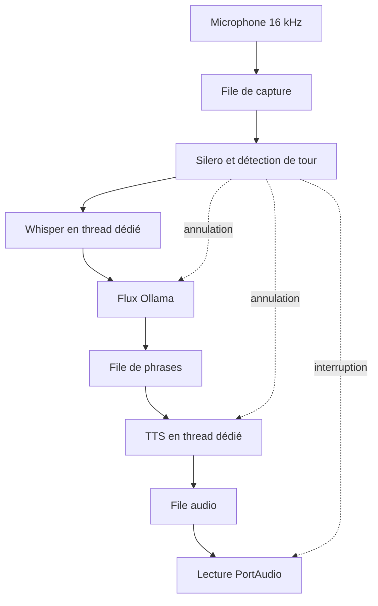
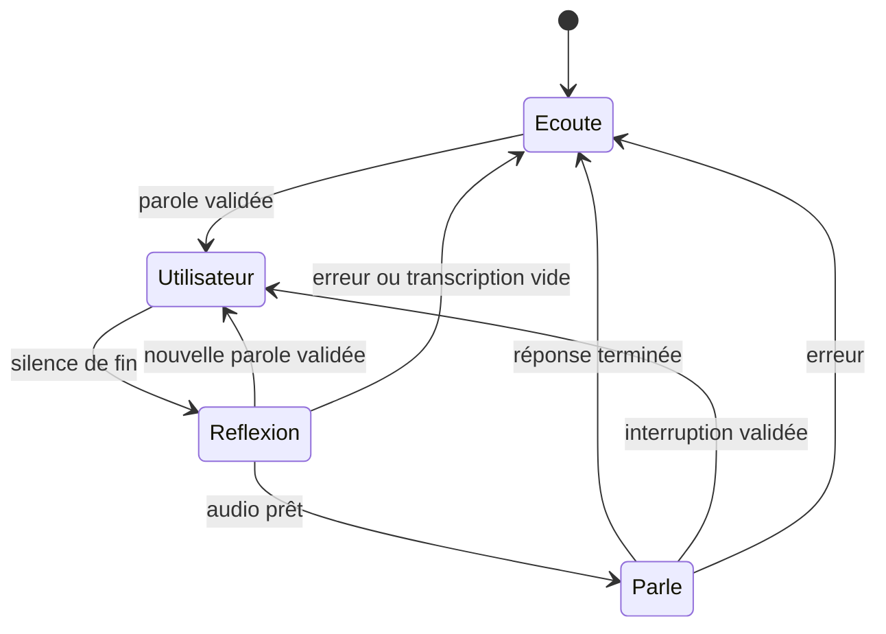

# Architecture

La capture PortAudio alimente une file bornée depuis son callback. Le consommateur
asyncio calcule la probabilité Silero sur CPU, accumule un segment et déclenche un
tour. La capture continue pendant la réponse. `TurnDetector` ne dépend d'aucun modèle.

## Possession des ressources

Une tâche de réponse possède un `TaskGroup` de trois tâches : LLM, TTS, lecture.
Chaque tour crée ses propres files (4 phrases et 3 blocs synthétisés). L'annulation
détruit ces consommateurs ; les sorties retardées ne rejoignent pas un nouveau tour.
Le STT et le TTS disposent chacun d'un exécuteur à un thread, distinct du VAD.

Python ne peut pas tuer une inférence native déjà lancée avec sécurité. L'annulation
arrête donc l'attente et interdit la lecture du résultat ; le prochain calcul du
même moteur attend la fin de celui qui reste en cours. Cette attente peut augmenter
la latence après une interruption. La file de capture accepte au plus 64 blocs.
Les débordements et statuts PortAudio sont tracés, pas cachés.

## Machine à états

L'état `Parle` signifie que l'audio est remis au lecteur. Le temps de première
lecture utilisé par le rapport provient du DAC, indépendamment de cet état.

## Interruption et historique

La validation exige 10 blocs de 32 ms au seuil strict, soit 320 ms. Les blocs du
candidat et environ 224 ms de pré-roll sont préservés. L'ordre est : invalider la
génération audio, vider/abandonner la sortie, relever l'accusé d'arrêt hôte, annuler
les trois tâches, fermer le flux HTTP, finaliser l'historique et repartir en écoute.

La mémoire contient six paires utilisateur/assistant. Un texte TTS n'entre dans
cette mémoire qu'après la fin estimée de son dernier échantillon au DAC. L'unité
est la phrase synthétisée entière ; une phrase coupée est perdue. Cette convention
est plus conservatrice que le découpage proportionnel au nombre d'échantillons,
qui pourrait affirmer qu'un mot jamais joué a été entendu.

## Horloges

Tous les événements utilisent `perf_counter_ns`. Les temps ADC/DAC de PortAudio
sont convertis vers cette horloge par différence avec `currentTime` au callback.
`speech_end_real` est la fin de la dernière trame classée comme parole, donc une
estimation VAD et pas une annotation acoustique indépendante.

`playback_start` représente le temps DAC estimé. `playback_stopped` représente le
retour de `abort()` côté hôte. Mesurer l'arrêt acoustique dans la pièce nécessite
un enregistrement de boucle externe ; aucun chronomètre logiciel ne prouve cela.

Les callbacks ne font ni disque, ni réseau, ni inférence. Le JSONL est écrit par
un thread dédié, ligne par ligne, et fermé proprement. La file de traces est bornée
à 10 000 événements et échoue explicitement si le disque ne suit pas.
